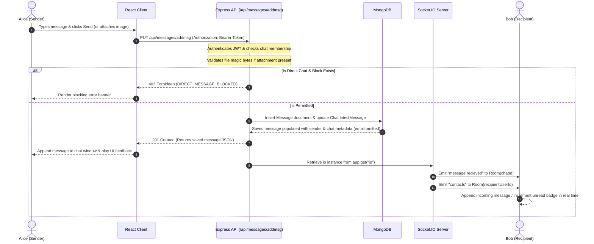

# Orbit — Modern Real-Time Messaging Platform

<div align="center">


**A secure real-time chat application built on the MERN stack (MongoDB, Express, React, Node.js) with Socket.IO, featuring user authentication, direct profile management, multi-admin group management, authenticated file attachments, and comprehensive authorization controls.**

[](https://react.dev/)
[](https://nodejs.org/)
[](https://expressjs.com/)
[](https://www.mongodb.com/)
[](https://socket.io/)
[](https://helmetjs.github.io/)
[](https://sass-lang.com/)
[](https://jestjs.io/)

</div>

---

## Table of Contents

- [Overview](#overview)
- [Key Features](#key-features)
- [Architecture & Application Flow](#architecture--application-flow)
- [Technology Stack](#technology-stack)
- [Project Directory Structure](#project-directory-structure)
- [Prerequisites](#prerequisites)
- [Environment Configuration](#environment-configuration)
  - [Backend (`server/.env`)](#backend-serverenv)
  - [Frontend (`public/.env`)](#frontend-publicenv)
- [Installation & Local Setup](#installation--local-setup)
  - [Windows (PowerShell)](#windows-powershell)
  - [macOS / Linux (Bash)](#macos--linux-bash)
- [Running Tests & Production Build](#running-tests--production-build)
- [Message Lifecycle & Real-Time Data Flow](#message-lifecycle--real-time-data-flow)
- [REST API Reference](#rest-api-reference)
  - [Authentication Routes (`/api/auth`)](#authentication-routes-apiauth)
  - [Chat Management Routes (`/api/chats`)](#chat-management-routes-apichats)
  - [Messages Routes (`/api/messages`)](#messages-routes-apimessages)
  - [Contact Privacy & Blocking Routes (`/api/blocks`)](#contact-privacy--blocking-routes-apiblocks)
- [Security & Validation Controls](#security--validation-controls)
- [Performance & Scalability Considerations](#performance--scalability-considerations)
- [Deployment Guidance](#deployment-guidance)
- [Future Roadmap](#future-roadmap)

---

## Overview

**Orbit** is a full-stack real-time messaging platform designed for personal and team communication. Built on the **MERN** stack, Orbit couples the reactivity of a React single-page frontend with the robust concurrency of an Express.js and Node.js backend, backed by MongoDB for persistent document storage and Socket.IO for low-latency bidirectional messaging.

Orbit prioritizes user privacy, data security, and operational reliability:
- **Strict Hybrid Architecture**: All mutations (messages, profile modifications, group management) are authorized and validated through RESTful HTTP endpoints before any Socket.IO events are dispatched.
- **Private Attachment Access Control**: Uploaded message attachments are never publicly accessible; they require authenticated session tokens and chat membership verification.
- **Binary Magic Byte Inspection**: Uploaded media undergo binary signature validation to prevent script or executable uploads disguised as images.
- **Direct & Frictionless Authentication**: Fast registration and login without external SMTP dependencies, verification barriers, or third-party email providers.
- **Comprehensive Rate Limiting**: Sensitive auth endpoints (registration, login) are protected by sliding-window rate limiters.

---

## Key Features

### 🔐 Robust Authentication & Account Security
- **Direct User Registration**: New users can register and immediately begin chatting. Passwords are securely hashed with `bcrypt` (10 salt rounds), and authenticated session tokens are generated instantly.
- **Sliding-Window Rate Limiting**: Protects registration and login endpoints against automated credential stuffing and brute-force attacks.
- **Direct Profile Management**:
  - Authenticated users can modify their own username, email address, profile picture, or password.
  - Email updates validate format and uniqueness, rejecting duplicates or unauthenticated requests while preserving authorization integrity.
- **Account Deletion Safety**: Deleting an account safely purges direct chats, blocks, and custom avatars while preserving group chats and messages sent by surviving members.
- **JWT Authorization**: Authenticated API requests and Socket.IO handshakes require a valid JSON Web Token (`Bearer <token>` or `?token=<token>`).

### 💬 Real-Time Messaging & Presence
- **One-on-One Direct Conversations**: Fast, private messaging between individual users.
- **Instant Message Broadcasting**: Messages appear instantly in the chat window of active conversation participants via Socket.IO rooms.
- **Pagination & Cursor Support**: Conversation histories are queried with limit, page, and cursor bounds (`limit`, `page`, `before`), returning response headers (`X-Total-Count`, `X-Total-Pages`) and structured pagination payloads.
- **Typing Indicators**: Visual indicators inform participants when the active peer is composing a message.
- **Authenticated Attachment Sharing**: Users can upload and share image attachments within messages. Attachments are served exclusively through an authenticated, membership-verified endpoint (`/api/messages/attachment/:filename`).
- **Custom Emoji Picker**: Integrated `emoji-picker-react` modal for expressive messaging.

### 👥 Advanced Group Chat Management
- **Multi-Admin Permissions**: Groups support multiple administrators (`groupAdmins` array). Admins can promote other members to admins or demote admins.
- **Group Administration**: Admins can rename groups, add or remove members, update group avatars, or delete the group entirely.
- **Safe Exit & Auto-Transfer**: When an admin leaves a group, admin privileges are automatically transferred to another active member if other admins do not exist. Non-admins can freely exit groups at any time.

### 🚫 Contact Privacy & Blocking
- **Direct Message Blocking**: Users can block contacts to prevent unwanted direct communications.
- **Enforced at Database Layer**: Block relationships are tracked via a dedicated `Block` collection. Attempting to send a direct message to or from a blocked user is rejected with HTTP 403 (`DIRECT_MESSAGE_BLOCKED`).
- **Preserved History & Group Coexistence**: Blocking prevents direct messaging without rewriting chat histories or disrupting common group conversations.

### ⚡ Live Profile & Username Synchronization
- **Real-Time Username Updates**: Changing a username immediately broadcasts a `user updated` socket event to all active conversation partners and group members without requiring a page refresh.
- **Profile Picture Uploads**: Custom profile pictures are handled via Multer disk storage and served via an Express static directory with magic byte validation.

### 🎨 Theme & Modern Responsive UI
- **Dual Themes**: Full light-mode and dark-mode support powered by SCSS design tokens and modular mixins.
- **Responsive Navigation Drawer**: Optimized layout for both desktop widescreen viewports and mobile devices with collapsible navigation drawers.

---

## Architecture & Application Flow

Orbit employs a hybrid architecture separating state mutation from real-time event dissemination:

```
[React SPA Client]
    │
    ├── (1) HTTP REST Mutations (JWT Auth + Validation)
    │       ▼
    │   [Express Backend] ── (2) Persist ──> [MongoDB Database]
    │       │
    │       └── (3) If Authorized & Persisted ──> [Socket.IO Server]
    │                                                     │
    └── (4) Real-Time Events (Broadcast to Room) ◄────────┘
```

---

## Technology Stack

| Domain | Technology | Version | Purpose |
| :--- | :--- | :--- | :--- |
| **Frontend Core** | [React](https://react.dev/) | `^18.2.0` | Declarative component UI library |
| **Routing** | [React Router DOM](https://reactrouter.com/) | `^6.4.3` | Client-side routing, route guards & redirects |
| **HTTP Client** | [Axios](https://axios-http.com/) | `^1.7.9` | Promise-based HTTP client for API consumption |
| **Real-Time Client** | [Socket.IO Client](https://socket.io/) | `^4.8.1` | WebSocket / polling client event bus |
| **Styling** | [Sass (SCSS)](https://sass-lang.com/) | `^1.58.3` | Modular SCSS stylesheets, variables, and themes |
| **Icons & Emojis** | [React Icons](https://react-icons.github.io/react-icons/) / [Emoji Picker](https://www.npmjs.com/package/emoji-picker-react) | `^4.7.1` / `^3.5.1` | UI glyphs and conversational emoji keyboard |
| **Backend Runtime**| [Node.js](https://nodejs.org/) | `>=18.16.0` | JavaScript runtime environment |
| **Web Framework** | [Express](https://expressjs.com/) | `^4.21.2` | HTTP REST API server framework |
| **Database ODM** | [Mongoose](https://mongoosejs.com/) | `^6.13.9` | Object Data Modeling for MongoDB schemas |
| **Real-Time Server**| [Socket.IO](https://socket.io/) | `^4.8.1` | WebSocket event broadcaster and room router |
| **Security Headers**| [Helmet](https://helmetjs.github.io/) | `^8.0.0` | HTTP security headers (nosniff, HSTS, CORP) |
| **Security / Auth** | [JSONWebToken](https://github.com/auth0/node-jsonwebtoken) / [Bcrypt](https://www.npmjs.com/package/bcrypt) | `^9.0.0` / `^5.1.0` | Stateless session signing and password hashing |
| **File Handling** | [Multer](https://github.com/expressjs/multer) | `^2.5.0` | Secure multipart form-data parser with magic byte validation |
| **Testing** | [Jest](https://jestjs.io/) / [Supertest](https://github.com/ladjs/supertest) / [RTL](https://testing-library.com/) | Modern | Unit, integration, and UI component test suites |

---

## Project Directory Structure

```text
chat-app-mern-master/
├── .env.example                 # Root environment variable template
├── .gitignore                   # Git exclusion patterns (secrets, logs, modules)
├── LICENSE                      # Standalone project license
├── README.md                    # Project documentation and architectural guide
├── package.json                 # Root package configuration
├── public/                      # Frontend React Application
│   ├── .env                     # Client environment configuration (local dev)
│   ├── .env.example             # Frontend environment template with production notes
│   ├── package.json             # Frontend dependencies and test scripts
│   ├── src/
│   │   ├── index.js             # React DOM root entry point
│   │   ├── App.js               # Route declarations and theme wrapper
│   │   ├── assets/              # Static SVG logos, loaders, and graphics
│   │   ├── components/          # Reusable interface components
│   │   │   ├── Avatar.jsx       # User profile and default avatar renderer
│   │   │   ├── ChatContainer.jsx# Main messaging conversation view
│   │   │   ├── ChatInput.jsx    # Text input, file upload trigger, and emoji menu
│   │   │   ├── Contacts.jsx     # Active chat list, user search, and drawer toggle
│   │   │   ├── NavigationDrawer.jsx # Slide-out drawer for settings and themes
│   │   │   ├── RouteGuards.jsx  # Unauthenticated redirection guards
│   │   │   ├── Search.jsx       # User search modal for initiating conversations
│   │   │   ├── SingleChat.jsx   # Active chat header, options menu, and status
│   │   │   ├── UpdateProfile.jsx# User profile, username, email, and password modal
│   │   │   ├── UserInfo.jsx     # Contact detail display and blocking controls
│   │   │   ├── Authorization/   # Login and registration form components
│   │   │   ├── Aux/             # Badges, user list items, and confirmation modals
│   │   │   └── Group/           # Group creation and group settings modals
│   │   ├── config/              # Helper utilities (ChatLogics, sender formatting)
│   │   ├── context/             # Global React Context (ChatProvider, state)
│   │   ├── pages/               # Top-level view routes (Chat, Authorization)
│   │   ├── scss/                # Modular SCSS styling, mixins, and theme palettes
│   │   └── utils/               # Axios route maps and constants
│
└── server/                      # Backend Express & Socket.IO Application
    ├── .env                     # Backend environment file (Git ignored)
    ├── .env.example             # Backend environment template with instructions
    ├── app.js                   # Express setup, security headers, CORS, and error handlers
    ├── index.js                 # Server entry point, DNS config, and DB connection
    ├── package.json             # Backend dependencies, engines, and test scripts
    ├── socket.js                # Socket.IO authorization, rooms, and event routing
    ├── config/                  # JWT token generator utilities
    ├── controller/              # Request handlers (auth, chats, messages, blocks)
    ├── images/                  # Local storage directories for uploaded media
    │   ├── attachments/         # Message attachment storage (private, authenticated)
    │   └── profile_pictures/    # User profile pictures (public static)
    ├── middleware/              # Auth verification, rate limiting, and upload validation
    ├── model/                   # Mongoose schemas (User, Chat, Message, Block)
    ├── routes/                  # Express REST route definitions
    ├── tests/                   # Backend Jest and Supertest test suites
    └── utils/                   # DNS config and group admin helpers
```

---

## Prerequisites

Before setting up Orbit locally, ensure your development environment satisfies:

1. **Node.js**: `v18.16.0+` or `v20.x` LTS. Check with:
   ```bash
   node -v
   ```
2. **npm**: `v9.x` or later. Check with:
   ```bash
   npm -v
   ```
3. **MongoDB**:
   - A local MongoDB Community Server instance (`mongodb://127.0.0.1:27017/orbit`) or
   - A free [MongoDB Atlas](https://www.mongodb.com/atlas) cloud cluster (`mongodb+srv://...`).

---

## Environment Configuration

### Backend (`server/.env`)

Create a `.env` file in the `server/` directory (you can copy `server/.env.example`):

```env
# Required: Server Port (defaults to 5000 if omitted)
PORT=5000
NODE_ENV=development

# Required: MongoDB Connection String (Local or Atlas)
MONGODB_URL=mongodb+srv://<username>:<password>@cluster0.mongodb.net/orbit?retryWrites=true&w=majority

# Required: JWT Signing Secret (Minimum 32 characters recommended)
JWT_SECRET=your_super_secret_jwt_key_at_least_32_chars_long

# Required: Frontend URL(s) (comma-separated if multiple origins, used for CORS)
CLIENT_URL=http://localhost:3000

# Optional: Reverse Proxy Configuration (set to "true" when behind Nginx, Render, Heroku, Cloudflare, etc.)
TRUST_PROXY=false

# Optional: DNS Override configuration for environments where SRV lookups fail (e.g. Windows Node.js)
# ENABLE_DNS_OVERRIDE=true
# DNS_SERVERS=8.8.8.8,1.1.1.1
```

> **DNS SRV Resolution Note**: Certain Node.js versions on Windows or restricted local networks fail to resolve MongoDB Atlas SRV records (`_mongodb._tcp...`) with `querySrv ECONNREFUSED`. In such cases, setting `ENABLE_DNS_OVERRIDE=true` and `DNS_SERVERS=8.8.8.8,1.1.1.1` configures Node's DNS resolver via `node:dns` before establishing the database connection.

### Frontend (`public/.env`)

Create or review the `.env` file in the `public/` directory (you can copy `public/.env.example`):

```env
# Required: LocalStorage Key for Session Persistence
REACT_APP_LOCALHOST_KEY="chat-app-user"

# Optional: Backend API and Socket URLs (defaults to http://localhost:5000 in local dev)
REACT_APP_API_URL=http://localhost:5000
REACT_APP_SOCKET_URL=http://localhost:5000

# Optional: Base URL for Profile Pictures (defaults to ${REACT_APP_API_URL}/images/profile_pictures/)
# REACT_APP_PROFILE_PICS_PATHS="http://localhost:5000/images/profile_pictures/"

# Optional: Custom Media Path for Attachments (defaults to authenticated backend route)
# REACT_APP_ATTACHMENT_PATHS="http://localhost:5000/api/messages/attachment/"
```

---

## Installation & Local Setup

### Windows (PowerShell)

```powershell
# 1. Clone the repository
git clone https://github.com/I-Appy-I/Orbit.git
Set-Location -Path Orbit

# 2. Install backend dependencies
Set-Location -Path server
npm install

# 3. Create and configure server environment file
Copy-Item -Path .env.example -Destination .env
# Open server/.env and fill in your MONGODB_URL and JWT_SECRET

# 4. Install frontend dependencies
Set-Location -Path ../public
npm install
Copy-Item -Path .env.example -Destination .env

# 5. Start the backend server (Terminal 1)
# From server directory:
npm run dev   # or: npm start

# 6. Start the frontend React development server (Terminal 2)
# From public directory:
npm start
```

### macOS / Linux (Bash)

```bash
# 1. Clone the repository
git clone https://github.com/I-Appy-I/Orbit.git
cd Orbit

# 2. Install backend dependencies
cd server
npm install

# 3. Create and configure server environment file
cp .env.example .env
# Edit server/.env with your preferred text editor (nano, vim, etc.)

# 4. Install frontend dependencies
cd ../public
npm install
cp .env.example .env

# 5. Start the backend server (Terminal 1)
cd ../server
npm run dev   # or: npm start

# 6. Start the frontend server (Terminal 2)
cd ../public
npm start
```

---

## Running Tests & Production Build

### Backend Tests
The server test suite uses **Jest** and **Supertest** to execute integration tests covering authentication, rate limiting, direct email updates, permissions, contact blocking, message pagination, magic byte file validation, DNS fallbacks, and Socket.IO authorization:

```bash
cd server
npm test
```

### Frontend Tests
The frontend suite uses **React Testing Library** and **Jest** to test UI components, route protection, profile updates, and chat logic calculations:

```bash
cd public
npm test -- --watchAll=false
```

### Production Build
To create an optimized production build of the React frontend:

```bash
cd public
npm run build
```
This produces optimized, gzipped static assets in `public/build/`.

---

## Message Lifecycle & Real-Time Data Flow



---

## REST API Reference

All protected endpoints require the HTTP header:
```http
Authorization: Bearer <your_jwt_token>
```
Or for media attachments:
```http
GET /api/messages/attachment/:filename?token=<your_jwt_token>
```

### Authentication Routes (`/api/auth`)

| Method | Endpoint | Access | Description |
| :--- | :--- | :--- | :--- |
| `POST` | `/api/auth/register` | Public (Rate-Limited) | Register new user. Accepts `multipart/form-data` with optional `profilePic`. Validates magic bytes. Returns user record and JWT session token. |
| `POST` | `/api/auth/login` | Public (Rate-Limited) | Authenticate user credentials. Returns user record and JWT session token. |
| `GET` | `/api/auth/me` | Protected | Returns profile data for the authenticated session user. |
| `GET` | `/api/auth/allUsers` | Protected | Fetch directory of all users with mutual block status flags for search. |
| `PUT` | `/api/auth/renameUser` | Protected | Update username. Broadcasts real-time `user updated` socket event. |
| `PUT` | `/api/auth/emailUpdate` | Protected | Update email address. Validates new email format and uniqueness, updating user email directly. |
| `PUT` | `/api/auth/passwordUpdate` | Protected | Update user password after validating existing password. |
| `PUT` | `/api/auth/profilePicUpdate` | Protected | Upload new profile image (`multipart/form-data`) with magic byte validation. |
| `PUT` | `/api/auth/deleteUser` | Protected | Permanently delete user profile, direct chats, and avatar while preserving group chat messages. |

### Chat Management Routes (`/api/chats`)

| Method | Endpoint | Access | Description |
| :--- | :--- | :--- | :--- |
| `POST` | `/api/chats/accessChat` | Protected | Open or initialize a 1-on-1 direct chat with `userId`. |
| `GET` | `/api/chats/fetchChats` | Protected | Fetch all active direct and group conversations for the authenticated user. |
| `POST` | `/api/chats/group` | Protected | Create a new group conversation with name and member list. |
| `PUT` | `/api/chats/rename` | Protected (Admin) | Rename an existing group conversation. |
| `PUT` | `/api/chats/groupadd` | Protected (Admin) | Add one or more members to an existing group. |
| `PUT` | `/api/chats/groupremove` | Protected (Admin) | Remove a member from a group. |
| `PUT` | `/api/chats/groupadmin` | Protected (Admin) | Promote a member to admin or demote an existing admin (`action: "promote" \| "demote"`). |
| `PUT` | `/api/chats/groupexit` | Protected | Voluntarily leave a group conversation. Automatically transfers admin if required. |
| `PUT` | `/api/chats/grouppic` | Protected (Admin) | Update group avatar image (`multipart/form-data`). |
| `PUT` | `/api/chats/deleteChat` | Protected (Admin) | Delete group chat permanently. |

### Messages Routes (`/api/messages`)

| Method | Endpoint | Access | Description |
| :--- | :--- | :--- | :--- |
| `PUT` | `/api/messages/addmsg` | Protected | Persist and send a message. Accepts text `content` and optional `attachment` file. Checks block status and emits Socket.IO event. |
| `GET` | `/api/messages/getmsg/:chatId` | Protected | Fetch paginated chat messages. Supports query params: `limit` (default 50), `page` (default 1), `before` (ISO date cursor), and `paginated=true`. |
| `GET` | `/api/messages/attachment/:filename` | Protected | Retrieve private message attachment file. Verifies chat membership and path traversal. |

### Contact Privacy & Blocking Routes (`/api/blocks`)

| Method | Endpoint | Access | Description |
| :--- | :--- | :--- | :--- |
| `GET` | `/api/blocks/:userId` | Protected | Check bidirectional block status between authenticated user and `userId`. |
| `POST` | `/api/blocks/:userId` | Protected | Block a target user, preventing mutual direct messaging. |
| `DELETE` | `/api/blocks/:userId` | Protected | Unblock a target user. |

---

## Security & Validation Controls

Orbit implements defense-in-depth across the entire application stack:

1. **Private Attachment Protection**:
   Unlike profile pictures (which are public avatars), message attachments are **never served statically**. All attachment requests pass through `GET /api/messages/attachment/:filename`, which validates the user's JWT and verifies that the user is an active participant of the chat containing the attachment. Path traversal attempts (`..`) are strictly rejected.
2. **Binary Magic Byte Inspection**:
   File uploads are not trusted solely by extension or client-reported MIME type. Upload middleware validates the initial binary magic bytes on disk:
   - JPEG: `FF D8 FF`
   - PNG: `89 50 4E 47`
   - GIF: `47 49 46 38`
   - WEBP: `RIFF` ... `WEBP`
   Disguised scripts or executable files are immediately unlinked and rejected with HTTP 400.
3. **Rate Limiting on Sensitive Auth Endpoints**:
   Custom sliding-window rate limiters protect registration (10 req/15min) and login (15 req/15min) against automated abuse.
4. **Security Headers with Helmet**:
   Express integrates `helmet()` to enforce `X-Content-Type-Options: nosniff`, HSTS, X-Frame-Options (`DENY`), and DNS prefetch controls, with cross-origin resource policy configured for avatar embedding.
5. **Data Privacy**:
   Message sender population explicitly excludes the `email` field (`populate("sender", "username profilePic")`), preventing participant email addresses from leaking in message histories or Socket.IO payloads.
6. **Strict Socket Handshake Authentication**:
   Socket.IO connections execute a JWT verification middleware upon connection. Missing, unverified, or expired tokens are rejected immediately.
7. **Guarded Room Join Logic**:
   When a client requests `socket.emit("join chat", roomId)`, the server verifies that `socket.user._id` exists in the `chat.users` membership array. Unauthorized clients cannot eavesdrop on rooms.
8. **No Direct Socket Ingestion**:
   The server intercepts `socket.on("new message")` and emits an error instructing the client to use the authenticated REST endpoint, preventing spoofed message creation.
9. **JSON Body Limits**:
   Body parser size is constrained to `1mb` to prevent large payload Denial of Service attacks.

---

## Performance & Scalability Considerations

- **MongoDB Indexing**:
  - `Chat.directKey`: Unique sparse compound index on 1-on-1 chats to guarantee single conversation documents per user pair.
  - `Message.chat` & `Message.createdAt`: Compound indexing ensures fast reverse-chronological message lookups.
  - `Block.blocker` & `Block.blockedUser`: Compound unique index for $O(1)$ relationship checks.
- **Message Pagination**: Rather than loading thousands of messages into memory, Orbit leverages limit/page querying and cursor slicing (`before`), optimizing frontend rendering and minimizing server payload sizes.
- **Horizontal Scale-Out**: For multi-instance deployments behind a load balancer (e.g., NGINX, AWS ALB), integrate the [`@socket.io/redis-adapter`](https://socket.io/docs/v4/redis-adapter/) to route events across separate server nodes.

---

## Deployment Guidance

Orbit is architected as a two-tier system: an Express.js & Socket.IO backend coupled with a separately hosted React single-page frontend and a MongoDB Atlas database.

### Intended Architecture

```
[React SPA] (Vercel / Netlify / Cloudflare Pages / S3)
    │
    ├── HTTPS REST API calls & WSS Socket.IO connections
    ▼
[Node.js / Express API] (Render / Railway / Fly.io / AWS EC2)
    │
    ├── TLS Connection (SRV Lookup)
    ▼
[MongoDB Atlas Database]
```

### 1. Backend Deployment

- **Hosting Options**: Render, Railway, Fly.io, AWS EC2, or Heroku.
- **Root Directory**: `server`
- **Build Command**: `npm install`
- **Start Command**: `node index.js`
- **Required Environment Variables**:
  - `NODE_ENV=production`
  - `PORT=5000` (or provided by host)
  - `MONGODB_URL=mongodb+srv://...`
  - `JWT_SECRET=<strong_random_secret_at_least_32_chars>`
  - `CLIENT_URL=https://your-frontend-domain.com` (matches frontend origin for CORS)
- **Optional Environment Variables**:
  - `TRUST_PROXY=true` (must be set when deployed behind a reverse proxy or load balancer so client IP rate limiters function correctly)
  - `ENABLE_DNS_OVERRIDE=true` and `DNS_SERVERS=8.8.8.8,1.1.1.1` (only if the hosting environment's resolver cannot resolve Atlas SRV records)
- **Persistent File Storage Considerations**:
  - Orbit's Multer upload middleware stores files on local disk under `server/images/profile_pictures` and `server/images/attachments`.
  - On platforms with ephemeral container filesystems (e.g. standard Render web services or Heroku dynos), redeploying or restarting containers clears locally stored uploads.
  - To preserve uploads in production, mount a **persistent disk volume** to `server/images/` or migrate storage handlers to an S3-compatible cloud object store (AWS S3, Cloudflare R2, Google Cloud Storage).

### 2. Frontend Deployment

- **Hosting Options**: Vercel, Netlify, Cloudflare Pages, or AWS S3 + CloudFront.
- **Root Directory**: `public`
- **Build Command**: `npm run build`
- **Output Directory**: `build`
- **Required Environment Variables**:
  - `REACT_APP_API_URL=https://your-backend-api.onrender.com`
  - `REACT_APP_SOCKET_URL=https://your-backend-api.onrender.com`
  - `REACT_APP_LOCALHOST_KEY="chat-app-user"`
- **Single Page Application Routing**:
  Ensure hosting rewrites redirect all non-file route requests to `/index.html` (e.g., via `vercel.json` or `_redirects` for Netlify) so client-side React routes (`/chat`, `/login`, `/register`) resolve properly on browser refresh.

### 3. Production Readiness Considerations

While Orbit includes extensive security hardening and passes all automated test suites, taking any real-time application to full production scale requires infrastructure planning:
- Provisioning persistent disk storage or S3 storage for user media.
- Adding the Redis adapter for multi-instance Socket.IO clustering.
- Setting up application monitoring, logging, and error tracing (e.g., Sentry, Datadog).
- Restricting MongoDB Atlas network access to your backend server's static outbound IP addresses.

---

## Future Roadmap

- [ ] **End-to-End Encryption (E2EE)**: Implement client-side signal protocol encryption for 1-on-1 direct conversations.
- [ ] **Voice & Video Calling**: WebRTC-powered peer-to-peer audio and video communication.
- [ ] **Cloud Media Storage**: Transition local Multer storage to AWS S3, Cloudflare R2, or Cloudinary with CDN caching.
- [ ] **Message Reactions & Threaded Replies**: In-line emoji reactions and nested sub-threads for group discussions.
- [ ] **Web Push Notifications**: Service Worker integration for browser push notifications when offline.
- [ ] **Redis Pub/Sub Socket Adapter**: Multi-node horizontal scaling for Socket.IO.
